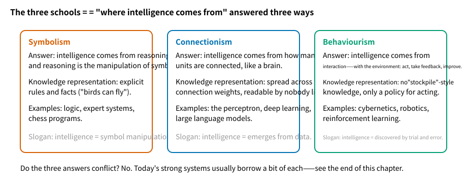
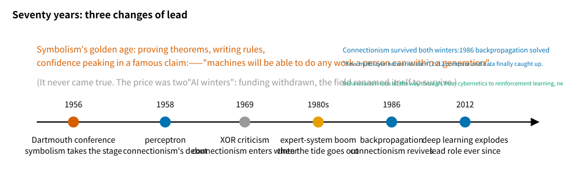
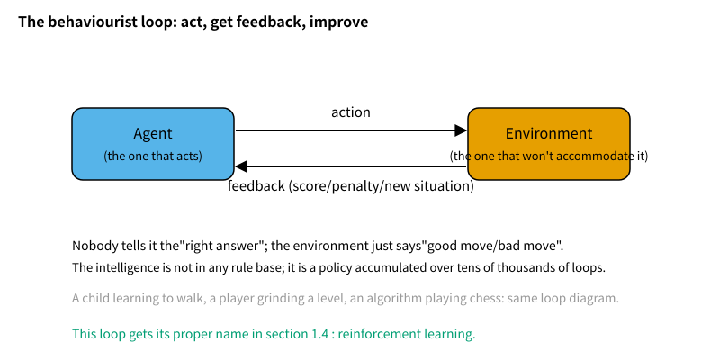

## The three schools of artificial intelligence {#sec:three-schools}

### The one-line intuition

Under the goal of "making machines intelligent" sit three more fundamental questions: where does intelligence actually come from? In seventy years there have been three serious answers — **from reasoning** (symbolism), **from connections** (connectionism), **from interaction** (behaviourism). The winner in today's headlines is the second, but the other two are not dead; their blood still runs in the systems you use every day.

What this section gives you is not a history lesson but **three pairs of glasses**: take any AI system, and first ask which pair it sees the world through.

### An analogy: three paths up a mountain

One summit, three paths. Symbolism builds a cable car: every stretch of track has to be laid in advance by a person — safe, explainable, but where the track does not reach, you cannot go. Connectionism plants a vine: give it soil and climate (data) and the vine grows itself, at an astonishing rate, but nobody can say why each tendril bends the way it does. Behaviourism lets a goat loose: it climbs, it falls, it remembers which path works — nobody teaches it, but it really does arrive.

On all three paths someone has announced "this is the only real way up". The lesson of seventy years is that **there is more than one summit, and not necessarily only one path.**

### The problem it solves: three answers and their golden ages

{#fig:schools}

**Symbolism** holds that intelligence is reasoning over symbols, so the core of an intelligent system is a clearly written knowledge base plus a set of inference rules. It gave birth to theorem proving, expert systems, and the earliest serious discussion of "can machines think" — in his 1950 paper Turing predicted that by the end of the century people would no longer argue about whether machines could think [3]. The claims made in its golden age later became its own burden: the rules can never be written completely, and even when they are, they cannot be maintained — this is the **knowledge acquisition bottleneck**, and the first-generation spam filter from section 1.1 is its miniature portrait.

**Connectionism** holds that intelligence is not in any single rule but in the way large numbers of simple units are connected. Its fortunes unfold in [section 1.3](03-00-neural-networks.md#sec:neural-networks) — two winters, two revivals, and today's leading large language models are its third-generation product.

**Behaviourism** holds that intelligence is not in the head but in the loop of "act, take the feedback, improve". Nobody hands it the right answer; the environment only says "good / bad", and the policy is accumulated by itself [4]. It runs from cybernetics all the way to robotics, never making headlines, never leaving the stage.

{#fig:schools-timeline}

There is a pattern on the timeline in [the figure above](#fig:schools-timeline) worth remembering: **each school's strongest years are exactly the other two's weakest** — funding, talent and patience move back and forth between the three, and the years when the move fails are called "AI winters". Textbooks organise them into three standard frameworks, divided by whether intelligence comes from reasoning, from learning, or from action [5], which line up one-to-one with the three schools here.

### Built-in limitations: each one's own wall

Each pair of glasses has somewhere it cannot see, and every wall grows out of that school's own assumptions:

For **symbolism** the wall is completeness: the world will not play by your rules, and the bigger the rule base, the more exceptions, until maintenance costs swallow all the gains. For **connectionism** the wall is transparency: the capability is stored in the weights, but nobody can read out "why it judged this way" — hard to fix when wrong, hard to explain when right. For **behaviourism** the wall is cost: trial and error means interacting with the world for real, a robot learning to walk has to take real falls, an agent learning to invest has to lose real money — not every environment allows you to try things at will.

{#fig:loop}

The behaviourist loop ([the figure above](#fig:loop)) is worth remembering on its own: **action, feedback, improvement** — nowhere on the ring is a "right answer" needed. This loop is the prototype of reinforcement learning in section 1.4, and it is also how the agents of section 1.7 improve themselves — the RSI stories are, at bottom, this loop wired into AI itself.

> **Common misconceptions**
>
> Thinking the three schools are historical relics and "only deep learning is left now". In reality today's winners are hybrids: the skeleton of a large language model is connectionist, much of the training that makes it "obedient" uses behaviourist feedback loops, and the part that calls a calendar or queries a database relies on precisely the old craft of symbolism — writing the world as a structure a machine can query. Do not throw away any of the three pairs of glasses.

### Summary and self-check

Three sentences: symbolism puts intelligence in clearly written rules, connectionism in the weights of connections, behaviourism in the loop with the environment; their walls are maintenance cost, opacity and the cost of trial and error; today's systems are a hybrid of all three.

Two questions to check yourself:

1. For an app that "takes a photo of a plant and tells you whether you can eat it", what does each pair of glasses contribute?
2. Why has the "knowledge acquisition bottleneck of expert systems" not disappeared with the arrival of large language models? (Hint: writing knowledge into rules and writing it into weights are different incarnations of the same difficulty.)
