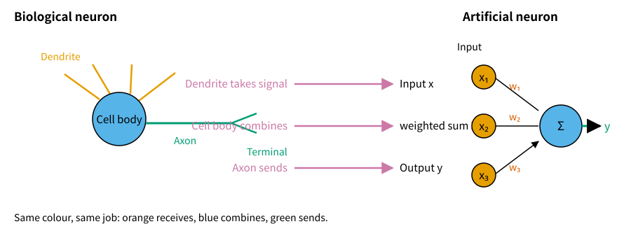
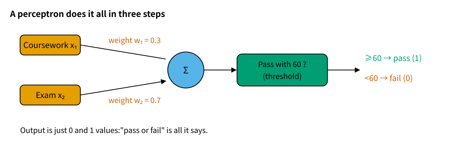
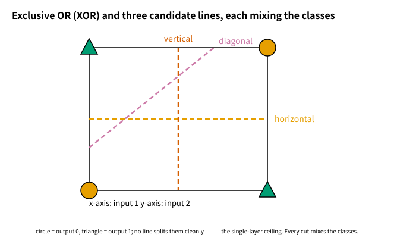
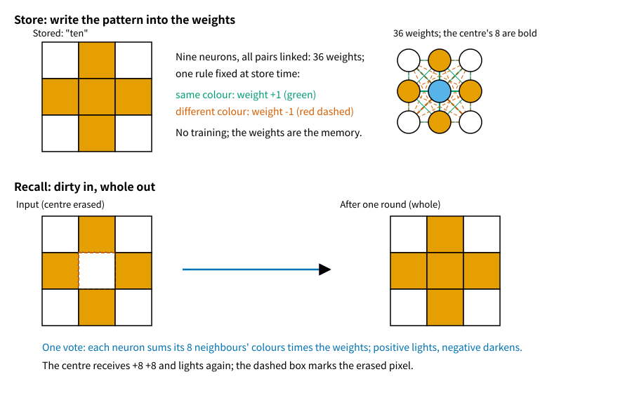

### Starting from a neuron

#### The one-line intuition

A human brain holds roughly eighty-six billion nerve cells[6], and each one does a single, extremely simple thing: it receives signals, and if they're strong enough it passes them on. No individual cell "understands" chess or reading, yet when they're wired together, those abilities appear. An artificial neuron copies that simple act exactly — and so, for the first time, something as complex as "intelligence" had a part you could compute with.

This section answers one question: **how can a pile of parts that only do addition, subtraction and comparison produce anything useful.**

#### An analogy you use every day

Think about how a course decides pass or fail: final grade = coursework × 30% + exam × 70%, and 60 or above is a pass.

That rule already contains every part of an artificial neuron: two **inputs** (coursework, exam), two **weights** (30%, 70%), one **weighted sum**, one **threshold** (60), one **output** (1 for a pass, 0 for a fail). You don't decide who passes by memorising "which students passed" — you fix the weights and the threshold, and any new student's marks go in and the answer comes out on its own.

A perceptron does exactly the same thing, except the weights aren't set by a person — they're tuned from data.

{#fig:neuron-mapping}

Parts of the same colour do the same job: dendrites take signals in, the cell body integrates them, the axon sends them out; in an artificial neuron these three are called input, weighted sum and output. Note that the mapping is functional, not anatomical: what got borrowed is only the division of labour into receive, combine, send.

#### The problem it solves

In 1943, McCulloch and Pitts proved something that looked impossible at the time: a logic unit that only does "weight, sum, threshold" can, once chained together, express any propositional logic[7]. That gave the idea that thought can be computed a concrete place to stand.

In 1958, Rosenblatt added one thing on top: the weights are not designed, they are **tuned from examples**[8]. That change is far bigger than it sounds. Before it, making a machine do a judgement task meant writing out every rule by hand — the symbolic approach, whose difficulties [Section 1.2](02-three-schools.md#sec:three-schools) described. The perceptron turned "do the task" into "tune the parameters": the rules moved out of human hands and into the data's.

So the word "learning" hasn't appeared yet in this section, but its stage is already set: **as long as there is a way to tune weights automatically, judgement can grow out of experience.** That way is called gradient descent, and it only takes the stage in [Section 1.3.3](03-03-learning.md#sec:learning).

{#fig:perceptron-sum}

#### What one neuron can and cannot do

Give the two inputs of [the figure above](#fig:perceptron-sum) the values 0 or 1, and the judgements this neuron can make all share one geometric shape: **draw a straight line on the plane; on one side the output is 1, on the other it's 0.** This isn't a metaphor — the weighted sum is precisely the equation of a line. The weights set its direction, the threshold sets how far it sits from the origin.

Anything a straight line can separate, a single-layer perceptron can do. Anything it can't separate, it can't do at all. The most famous counterexample is XOR: same inputs give 0, different inputs give 1. Draw the four points on the plane ([the figure below](#fig:xor)) and the two of each class always land on a diagonal, so any straight line must cut one of them over to the other side.

{#fig:xor}

Circles sit at (0,0) and (1,1), triangles at (0,1) and (1,0): each class owns one diagonal. Of the three candidate cuts, the horizontal and vertical ones mix the classes half and half, and the diagonal one barely keeps a single triangle while shoving the other three to the far side — none of them survives.

In 1969, Minsky and Papert argued this thoroughly enough in *Perceptrons*[9], and since nobody then knew how to get past the wall, perceptron research stalled for nearly twenty years. Looking back, the way past it was almost flippant in its simplicity: **add a few more neurons and fold straight lines into kinked ones.** But "how do you get the stacked neurons to each tune their own weights" had no answer until backpropagation arrived — that's the subject of [Section 1.3.3](03-03-learning.md#sec:learning).

Remember one test now, because it comes back again and again: **to judge a model, first ask what shape of boundary it can draw.** The shape of the boundary decides which tasks it is naturally suited to, and that's the earliest source of "built-in strengths and weaknesses".

#### A layer of interconnected neurons remembers a pattern

The last neuron was "pixels in, answer out". Now rearrange things: place nine neurons in a 3×3 grid, **connected to each other**, with no input layer and no output layer — each pixel position is itself a neuron, both an entrance and an exit.

How does a pattern get stored in the connections? There's one rule, fixed the moment you store it: **two cells with the same colour in the pattern get connection weight +1; different colours get -1.** Nine neurons, 36 connections, every weight computed straight from the pattern, no training at all — "set the pattern directly and let it remember", literally.

Memory works like this ([the figure below](#fig:pattern-memory)): show the network a pattern with a piece missing, and each neuron multiplies every companion's current colour by the connection weight and adds them all up — positive total, it lights; negative, it stays dark. This happens on all nine neurons at once, one round, and the pattern refreshes once.

{#fig:pattern-memory}

Do the arithmetic on the right half of [the figure above](#fig:pattern-memory): the "ten" that came in has had its centre erased, and the other eight pixels are correct. When it's the centre neuron's turn to vote, it counts its 8 companions — the 4 that shared its colour when the pattern was stored are now correctly lit and each contributes +1; the 4 that differed (the corners) are now correctly dark, and since different colour goes with negative weight, they also each contribute +1. Total **+8**, and the centre lights back up. Meanwhile each of the four arms computes +6 and stays lit, and each of the four corners computes -8 and stays dark — nobody gets dragged off course. One pixel wrong, one round of voting to fix it.

Networks like this are called **associative memory** today, and Hopfield proved in 1982 that this kind of voting always settles[10]. It's the simplest example of "a group of neurons directly remembers a pattern": **the weight table is the memory, recall is the vote.** And its built-in limitation is plain to see: this set of 36 weights knows exactly one pattern, "ten"; try to store an "X" as well and the two sets of weights fight — storing more means remembering more coarsely, and that's a tax every memory network pays.

#### Summary and self-check

Three sentences: an artificial neuron = weighted sum of inputs + threshold; a single-layer perceptron's boundary is a straight line, so what it can and can't do follows from that shape; and a group of neurons can also store a pattern directly in its connection weights and recall it by voting — the weight table is the memory, but one net holds only one thing.

Two self-check questions:

1. Change the threshold in [the figure above](#fig:perceptron-sum) from 60 to 90 — what happens to the decision boundary?
2. A friend says: "The more neurons you have, the more problems a single-layer perceptron can solve." What's wrong with that?

**Maths note.** All the maths this section uses is the two lines below. Write the inputs as $x_1, \dots, x_n$, the weights as $w_1, \dots, w_n$, and the bias as $b$ (which is just the negative of the threshold in [the figure above](#fig:perceptron-sum)):

Weighted sum:

$$z = \sum_{i=1}^{n} w_i x_i + b$$

Output (step activation):

$$y = \begin{cases} 1 & z \ge 0 \\ 0 & z < 0 \end{cases}$$

Connection weights and refresh rule for associative memory: when storing pattern $s$, $w_{ij} = +1$ if $s_i = s_j$, otherwise $-1$ (with $w_{ii}=0$); on recall each neuron computes $h_i = \sum_{j \ne i} w_{ij}\, s_j$, and lights if $h_i \ge 0$, stays dark if $< 0$.

How weights get tuned from data (the learning rule) is collected in [Section 1.3.3](03-03-learning.md#sec:learning).
