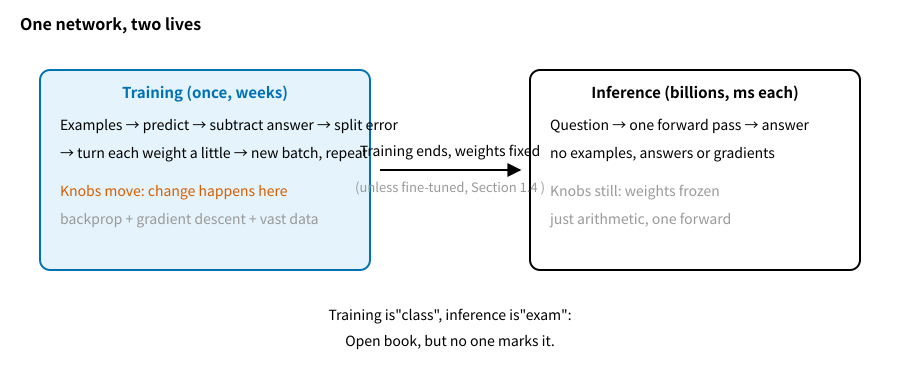
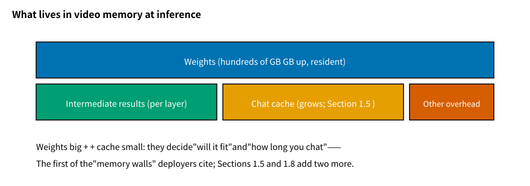

### Learning it and using it: training and inference {#sec:train-and-infer}

#### The one-line intuition

The "measure the error, turn the knobs" of [Section 1.3.3](03-03-learning.md#sec:learning) is **training**; once training ends and the knobs are frozen, giving the network a new question and having it compute forwards once for an answer is **inference**. One network, two lives: in training it changes, in inference it doesn't.

Separating these two is the precondition for understanding large-model cost, speed, and every question of the form "did it actually learn that".

#### An analogy: developing the recipe vs serving from it

New dish development at a restaurant chain is training: taste, take feedback, change the recipe, revise it dozens of times, with the best chefs and the most expensive ingredients, and weeks to finalise one dish. Serving from that recipe in every branch is inference: the recipe (the weights) is frozen, each plate is just execution, minutes apiece, millions of covers.

The key is where the line falls: **the moment the recipe is fixed.** After that, no matter how popular a branch's output is, the recipe doesn't change itself — unless head office decides on a new version, and that's a fresh round of training.

#### Two phases, two cost structures

{#fig:two-phases}

**Training** computes both forwards and backwards: forwards gives the prediction, backwards splits the bill and turns the knobs ([Section 1.3.3](03-03-learning.md#sec:learning)). It has to swallow vast amounts of data, run for weeks, burn the electricity of a whole machine room — but it **happens only once in its life** (strictly: once per model version).

**Inference** is forwards only: a question comes in, the signal passes left to right through the network, an answer comes out. No error, no gradient, no knob moves. A single inference takes milliseconds, but the world runs billions of them every day — **a cheap unit price times an astronomical count** is the real cost structure of a large-model company.

That's also why "what does one training run cost" and "what does one question cost" are two completely different quotes in the industry: the first is R&D, the second is a branch's ingredients and utilities.

#### What lives in video memory during inference

Inference computes less, but **the network weights must live in video memory in their entirety**, plus room for the computation in progress and the conversation history ([the figure below](#fig:memory)). That's the first of the "video memory walls" deployers go on about: whether a model can run at all depends on whether the wall is tall enough.

{#fig:memory}

Two threads get planted here, each with a section to pick it up later: why the conversation-history cache "grows and grows", which leads to the structure of attention ([Section 1.5.2](05-02-attention.md#sec:attention)) and the KV cache ([Section 1.8](08-compute-and-deployment.md#sec:compute-and-deployment)); and "what if the wall is too tall", which leads to quantization and precision ([Section 1.8](08-compute-and-deployment.md#sec:compute-and-deployment)).

#### Built-in limitations: once it's fixed, it learns nothing more from you

During inference, nothing you say and nothing you correct moves a single weight. Spend an afternoon arguing the model into silence, close the window, and next time it makes the same mistake — **there is no such thing as "remembering this lesson"** (to really change it you have to go back to the training side, which is called fine-tuning or alignment, [Section 1.6](06-alignment-hallucination-safety.md#sec:alignment-hallucination-safety)).

> **Common misconceptions**
>
> That "the AI is learning while it chats with me". Almost all of what users experience as "it understands me better now" comes from the preceding text it can see in the conversation window (the context, [Section 1.7.1](07-01-harness.md#sec:harness)), not from weights changing. Keep those two apart and a lot of confusion — "why has it forgotten everything in a new session", "why can't it learn my preferences" — disappears at once.

#### Summary and self-check

Three sentences: training computes forwards and backwards, the knobs move, and it happens once in a lifetime; inference computes forwards only, the knobs are frozen, and it happens billions of times a day; the video memory wall first constrains "will it fit", then "how long can we chat".

Two self-check questions:

1. A product claims "the more you chat with it, the better it understands you". Using this section's framework, list the two things you'd need to confirm to verify that claim.
2. A restaurant outsources "new dish development" to three branches to each try recipes. Describe the problem with that in the language of training and inference.
