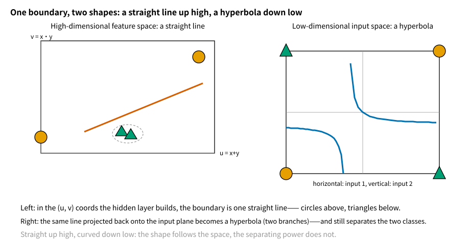
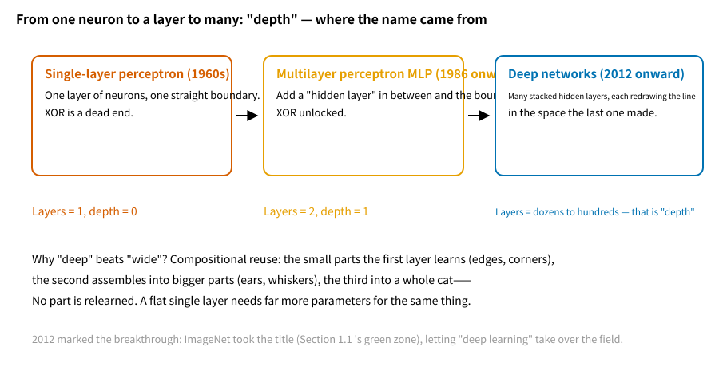

### A deeper brain: multilayer perceptrons and deep learning {#sec:mlp}

#### The one-line intuition

The single-layer perceptron of [Section 1.3.1](03-00-neural-networks.md#sec:neural-networks) can only draw one straight line; [Section 1.3.3](03-03-learning.md#sec:learning) showed how to turn the knobs, but no matter how many knobs there are, a one-layer network still draws straight lines. **Put a layer between the input and the output and the straight line learns to bend** — that layer is called the hidden layer, and with it the new era finally has something to attach the word "depth" to.

#### An analogy: answer the small questions first

Faced with "is this face a cat", nobody stares at pixels and concludes directly. You run a string of small questions in your head: does it have ears? Are the ears pointed? Is there a whisker? Each small question is one neuron, and their answers are pooled by a last neuron that draws the big conclusion.

**Answer the small questions, then answer the big one with those answers** — that is all a multilayer network does. Those "small-question neurons" sit between input and output, invisible and untouchable, which is why they are called the **hidden layer**.

#### The problem it solves: which space the line is drawn in

First, cash in the question [Section 1.3.3](03-03-learning.md#sec:learning) left hanging: how does a multilayer network get through XOR?

The trick is **a straight line in high dimensions, a projection in low ones**. The hidden layer sends every input into a new coordinate system: each dimension is one hidden neuron's yes/no answer. In that new space the boundary the network draws is a **flat hyperplane** — a straight line in a high-dimensional space; project the same surface back onto the familiar 2-D plane and it becomes a bent line, a band, or a boundary so complicated you cannot name its shape at first glance ([Figure 1-21](#fig:hidden-space)).

**One line, straight up high and complicated down low** — that is the entire secret of how an MLP solves XOR.

{#fig:hidden-space}

Projected back onto the original plane, that straight line shows its true face: **a hyperbola, its two branches cutting the corners of the two circles** — triangles on one side of the curve, circles on the other. Beating the XOR wall works exactly like this: it is not that one line learned to bend, but that a straight line in high dimensions can project down as a complicated curve.

{#fig:depth}

**The "deep" in "deep learning" is the number of hidden layers.** One layer is the post-1986 MLP; a dozen layers, a few hundred layers, is the deep network that took over the field after 2012 [15]. Why is stacking layers worth it? **Compositional reuse**: the small parts the first layer learns (edges, corners) are picked up directly by the second layer to build bigger parts (ears, whiskers), and the third assembles a whole cat — no part has to be learned twice. A flat, wide network needs far more parameters to express the same thing [16].

While we are here, one missing piece: in the curve-fitting mini-network of Section 1.3.3, the neurons passed their output straight through. In a real network every neuron goes through a **nonlinear activation** (say, "anything negative becomes zero"), because otherwise however many layers you stack, the whole pile collapses mathematically into a single straight line — **nonlinearity is what makes "depth" mean anything**, and it is the shared source of both the power of deep networks and their opacity [17].

#### Built-in limitations: three bills

The power of a deep network is bought with three things. **Data**: hundreds of millions of parameters means examples on the same scale, or you overfit ([Section 1.4.3](04-03-generalization.md#sec:generalization)). **Compute**: millions of forward-and-backward passes, each one touching the whole network — this is why deep learning slept until 2012, and what woke it was not a new theory but graphics cards. **Transparency**: the deeper the stack, the harder it is to answer "why did it decide that", and even the people who built it cannot say.

> **Common misconceptions**
>
> People assume "deep = smarter", that capability grows automatically as you add layers. Layers only supply **expressive potential** — the ability to draw more complicated boundaries; turning that potential into capability takes data and compute, and takes good training to realise. A very deep network with very little data losing to a shallow network with plenty of data is the norm, not news.

#### Summary and self-check

In three sentences: the hidden layer lets the network build a new space in which straight lines are enough, and a bent line in the old space is straight in the new one; stack hidden layers and you have deep learning, whose power comes from reusing parts compositionally; the price is three bills — data, compute and transparency.

Two self-check questions:

1. Draw the straight line from the right panel of [Figure 1-20](#fig:hidden-space) into the input space of the left panel — what shape does it take?
2. Why can a single neuron also draw a curved line if you feed it an x² among its inputs (the mini-network of [Section 1.3.3](03-03-learning.md#sec:learning))? What does that have in common with what a hidden layer does?

**Maths note.** Every hidden neuron: $h_j = f(\sum_i w_{ij} x_i + b_j)$, where $f$ is a nonlinear activation ($f(z)=\max(0,z)$, say, negatives to zero). A multilayer network is this expression nested over several layers. "Without $f$, depth collapses into one layer" takes one line to verify: composing two linear layers is still a linear map.
