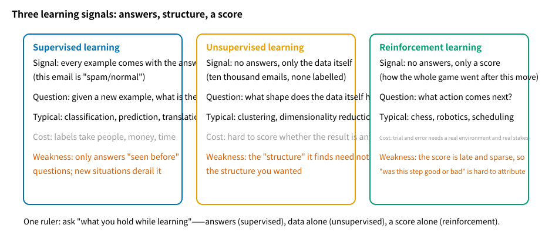
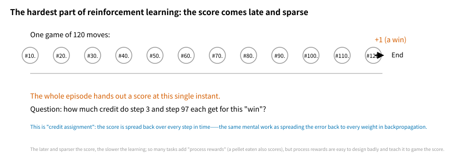

### Supervised, unsupervised and reinforcement learning {#sec:paradigms}

#### The one-line intuition

Three learning paradigms, and the only difference is **what signal you are holding while learning**: supervised learning has **the answer key**, unsupervised learning has **only the data itself**, and reinforcement learning has **a single score** — usually one handed over long after the fact.

The same problem asked three ways produces three completely different products and three different bills. If you can recognise which way is being asked, you can predict where it will be expensive and where it will fall over.

#### An analogy: three students learning to cook

The **supervised** student has a master chef standing alongside, tasting every dish the moment it is finished: "too much salt", "heat's too high". The feedback is dense, specific and repeatable — but the chef's tongue is expensive, and every dish needs someone to taste it.

The **unsupervised** student has no teacher, only a fridge full of ingredients, and sorts them by similarity: these have gone mouldy, these will keep a week. Nobody tells them whether the sorting is right; they might sort by origin, or by colour — **it can separate them, but the separation need not mean anything**.

The **reinforcement** student is an apprentice in a real restaurant: nobody says what was wrong with each dish, only the boss's remark at month end — "not bad this month". **The score arrives late, arrives rarely, and the student has to guess which step (which dish) earned it.**

{#fig:paradigms}

#### Supervised learning: learning with the answers

Ten thousand emails, each labelled "spam" or "normal", and the model learns to tell them apart — the spam filter of [Section 1.1](01-what-is-ai.md#sec:what-is-ai) is exactly this. Classification, regression, translation, speech recognition: all of them are doing the same thing underneath, **finding a mapping from input to answer given pairs of (input, answer).**

The cost is direct: somebody has to supply the answers. Medical images need a doctor to draw the boxes, legal documents need a lawyer to mark the clauses, dialect audio needs someone who speaks the dialect to transcribe it — **the price of labelling often exceeds the price of training**. The weakness is just as direct: it is reliable only within "the kinds of answer that have appeared before"; meet something absent from the training set and it forces the new thing into an old answer.

#### Unsupervised learning, and its most successful branch

This branch has no answers, so the machine has to find structure for itself: group similar things together (clustering), squash high dimensions into a few you can plot (dimensionality reduction), pick out the odd ones (anomaly detection). The manifold of [Section 1.3.3](03-03-learning.md#sec:learning) is exactly this in action — working out which sheet of paper the data lives on.

Its soft spot is that **there is no referee**: you get ten clusters, and are they "problem types" or "greeting lengths"? Nobody can count their way to an answer. Evaluation is hard, so it tends to be used as an exploration tool rather than a finished product on the production line.

But one of its branches went on to upend the whole industry. **Self-supervision**: split the data itself into "question" and "answer" — take a passage, mask the last word, have the model guess it; then check against the answer, which is the original text. **No labelling cost, and a near-infinite supply of practice questions.** Strictly it belongs to the unsupervised family, but it is far more powerful than the rest of it — large language models were raised on it, and [Section 1.5](05-00-llms.md#sec:llms) is about nothing else.

#### Reinforcement learning: learning from a score alone

Playing chess, teaching a robot to walk, scheduling jobs across a data centre — none of these has an answer key, only **how the ending went**: win or lose, fall or stand, power bill high or low.

The difficulty is not in the "learning", it is in **attribution** [18]: a game runs a hundred-plus moves, you win, so how much credit belongs to move 3 and how much to move 97? The score arrives once, at the very end, and usually very sparsely ([Figure 1-18](#fig:rl-delay)) — this is the **credit assignment** problem. Spreading the score backwards across every step is the same kind of mental work as backpropagation spreading the error back across every weight in [Section 1.3.3](03-03-learning.md#sec:learning).

{#fig:rl-delay}

The second trap in reinforcement learning is that **trial and error costs real money**: a robot learning to walk takes real falls, a recommender learning what to show offends real users. So real systems usually practise in a simulated environment first and fine-tune once live — and if the simulation is unlike reality, the skill does not transfer.

#### Built-in limitations: three signals, three kinds of damage

Supervision's damage is in **coverage**: it does not know the world beyond its answers. Unsupervised learning's damage is in **the referee**: the structure it finds need not mean anything, and is hard to verify. Reinforcement learning's damage is in **attribution and cost**: late sparse scores are hard to spread, and trial and error in a real environment burns money.

One practical test: **look at how it fails and you know which branch it is.** Wrong but "wrong with great confidence" is usually coverage (supervised); results that "look structured but are useless" are usually the referee (unsupervised); "great at gaming the score, useless at the job" is usually attribution (reinforcement).

> **Common misconceptions**
>
> People assume "unsupervised" means "nobody is in charge, it just learns whatever". Its precise meaning is "no answer key", and its success often depends on people more, not less — how the data is prepared, how the structure is interpreted, how the result is evaluated are all human work. Another common mistake is treating self-supervision as a fourth paradigm: it belongs to the unsupervised family, and "questions and answers both grown from the data" is its technique, not its category.

#### Summary and self-check

In three sentences: the three paradigms differ only in the learning signal — answers, data alone, a score alone; the core difficulty of reinforcement learning is credit assignment and the cost of trial and error; unsupervised learning has no referee, and its most successful branch, self-supervision, is what feeds every large model.

Two self-check questions:

1. A system that "predicts tomorrow's electricity price from historical demand curves" — which paradigm is it most likely to use? Where does its labelling cost sit?
2. Why can "process rewards" speed up reinforcement learning and yet also teach it bad habits? (Hint: the "gaming the score" in [Figure 1-18](#fig:rl-delay).)
