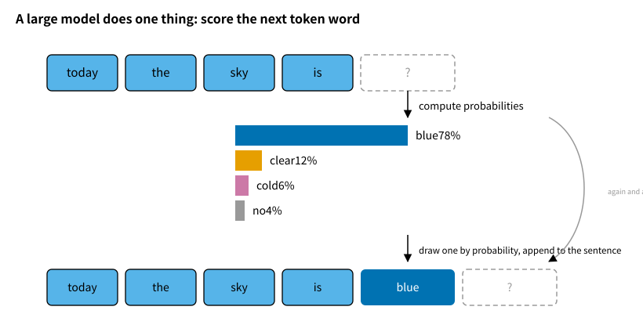
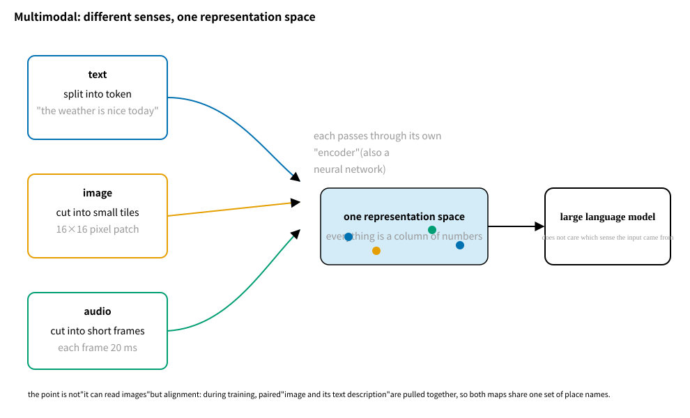
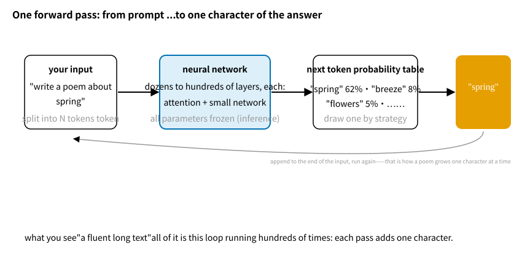

## Large language models {#sec:llms}

This chapter first lays out the premise shared by all three architectural routes: what large models do, how multimodality joins in, and why scale works (the first three sections); then we take the routes one by one. The reading order is the dependency order: skip the scaling laws and go straight to attention, and "why build them this big" won't make sense.

### Start with the simplest case: all it does is predict the next word {.unnumbered}

Strip away all the product packaging, and a large language model does exactly one thing in training: **give it some text, and it guesses what the next token is** ([Figure 1-23](#fig:next-token)). Then it checks the answer, and the answer is the original text — this is the self-supervision described in [Section 1.4.2](04-02-paradigms.md#sec:paradigms), with an endless supply of practice questions.

{#fig:next-token}

"It only guesses the next word" sounds unworthy of the word "intelligence". But to get the next word right, the model is forced to learn a great deal: predicting "sky" after "the" means knowing collocations, predicting 3288 after "137×24=" means doing arithmetic, predicting the title after "Jane Austen's best-known novel is" means remembering facts. **The prediction objective forces the model to compress every regularity in language into its parameters.** The abilities it shows are a by-product; the objective is always prediction. Models of this kind — self-supervised pretraining on enormous data, then adapted to all sorts of tasks — are collectively called **foundation models** [21].

### Multimodal: different senses, one representation space {.unnumbered}

Beyond text, images are cut into little tiles and audio into short frames, each passing through an encoder and all mapped into **the same representation space** (in [Figure 1-21](04-01-mlp-and-deep-learning.md#fig:hidden-space) we saw "everything is a column of numbers"; this is the multi-sensory version). The point isn't "it can read images" but **alignment**: during training, paired "image and its textual description" are pulled together in that space, so the model learns that both maps share one set of place names [22][23].

{#fig:multimodal}

### One forward pass, one character grown {.unnumbered}

The full inference loop ([Figure 1-23](#fig:forward)) is worth another look: input is cut into tokens → passes through dozens of layers → out comes a probability table for the next token → one is drawn by some strategy → it is stuck on the end of the sentence → go again. **The long answer you read is this diagram looping hundreds of times, each time growing a single character.**

{#fig:forward}

### Built-in limitations: predicting the next word doesn't judge truth {.unnumbered}

There is no "true" dimension in the training objective — the training data is the internet, and the internet holds both errors and truths, which the model learns from indiscriminately as "what usually comes next". **Fluency and truth were never distinguished in the training objective**; that is the mechanistic source of hallucination, expanded in [Section 1.6](06-alignment-hallucination-safety.md#sec:alignment-hallucination-safety).

> **Common misconceptions**
>
> The belief that "it checks before answering". By default it does no retrieval or verification at all — the probability table comes from regularities compressed into its parameters, not from a database. Products that do verify have wrapped retrieval around the outside, as described in [Section 1.7.3](07-03-mcp-skills-rag.md#sec:mcp-skills-rag).

### Qualitative tiers (as of the second half of 2026) {.unnumbered}

> **Capability tiers (qualitative, as of late 2026)**
>
> First tier (leading on general capability and ecosystem): GPT, Claude, Gemini, DeepSeek.
> Second tier (open-source and regional leaders): Llama, Mistral, Qwen, Gemma and others.
>
> Tiers only reflect "roughly where things sit on mainstream benchmarks and public experience"; no scores, no ranking. Places change by the month, so go by current public evaluations when you read this book.

### Summary and self-check {.unnumbered}

Three sentences: a large model does one thing, predict the next token; multimodality uses alignment to feed different senses into one representation space; fluency and truth were never distinguished in the training objective.

Two self-check questions:

1. Why is "self-supervision" decisive for this field? (Hint: think about the price of labels.)
2. A model needs hundreds of forward passes to finish one sentence, so what is the most direct way to "cut inference cost"?
