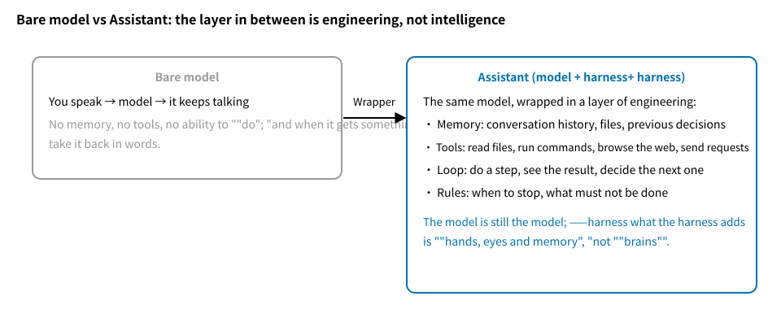
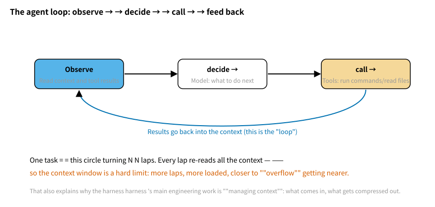
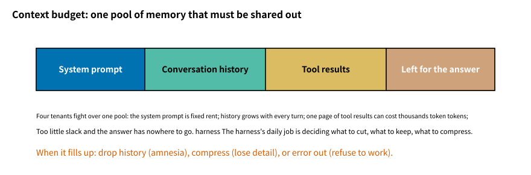

### The model's hands and feet: the harness {#sec:harness}

#### The one-line intuition

Between the assistant you use in a product and the bare "predict the next word" model of [Section 1.5](05-00-llms.md#sec:llms) sits a layer of engineering called the **harness**. What it adds is not intelligence but **hands, eyes and memory**: it can call tools, see the results, and remember last time's decision.

"Model + harness = agent" — the other two sections of this chapter are all about the advanced moves of that harness layer.

#### What the bare model lacks

{#fig:harness}

A bare model has only one channel: text in, text out. It says "I've deleted that file", but it has no hands — **saying it's done and it being done are the same act to it**. Nor has it any memory: anything outside this conversation does not exist. The harness supplies exactly these things.

#### The agent loop: observe → decide → call → feed back

At the heart of the harness is a loop ([Figure 1-45](02-three-schools.md#fig:loop)): the model reads the context once (observe) and decides what to do next (decide) — which may be to answer, or to call a tool; the harness runs the tool and feeds the result back into the context; then round again.

{#fig:loop}

The loop produces **a change of kind, not an addition**: a model on its own cannot "read a file", and the loop plus tools lets it — the capability comes from the combination of "model + tools + loop", not from more model parameters. Early work like ReAct showed exactly this: let the model "think while doing, look at the result and think again", and the same parameters become dramatically more usable[38]; SWE-agent later wrapped that loop around software-engineering tools and could fix real GitHub issues on its own[39].

#### Built-in limitations: the context budget

Every "observe" in the loop re-reads the whole context ([Figure 1-46](#fig:loop-budget)): the system prompt is fixed rent, the history grows with every exchange, a single page of tool output can be thousands of tokens, and blank space must be kept for the answer. **The daily engineering of a harness is managing this memory**: what comes in, what gets compressed, what gets dropped.

{#fig:loop-budget}

> **Common misconceptions**
>
> That the harness "bolts intelligence onto the model". Quite the opposite: everything inside a harness is deterministic engineering — file reads and writes, command execution, string concatenation. **All the intelligence comes from the model; all the reliability comes from the engineering**, and the cleaner that boundary, the easier the system is to maintain.

#### Summary and self-check

Three sentences: the harness fits the model with hands, eyes and memory; the agent loop (observe-decide-call-feed back) changes capability in kind; the context window is the loop's hard constraint, and managing it is the harness's main engineering job.

Two self-check questions:

1. Why is "I've fixed the code" from a model completely different in credibility from "the file really was changed" in the harness?
2. A task has gone round 40 times without finishing. What constraint is it most likely to hit first?

**Maths note.** No formulas in this section. One engineering fact: the attention cost for a context window of n is O(n²) ([Section 1.5.2](05-02-attention.md#sec:attention)), so "40 turns, re-reading the whole history each time" accumulates cost quadratically.
