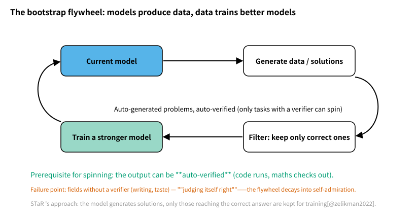
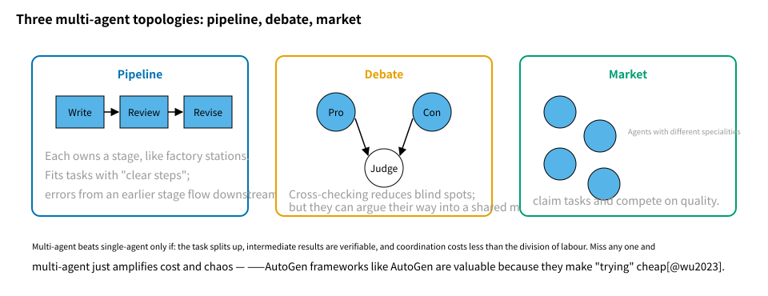
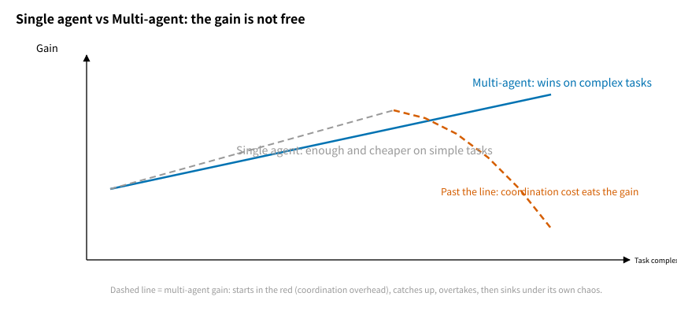

### Improving the agent: RSI and multi-agent {#sec:rsi-and-multi-agent}

#### The one-line intuition

There are two ways to make an agent stronger, and neither needs you to write more code: **self-improvement (RSI)** — use the current model to produce data, and train a better model from it; and **multi-agent** — several models dividing the work. Both are genuinely effective and both have clear failure points; the discipline of this section is: for every advantage, name when it stops holding.

#### Self-improvement: how the flywheel turns, and where it stops

{#fig:flywheel}

The bootstrap flywheel ([Figure 1-47](#fig:flywheel)): the current model generates solutions → keep only those that pass verification → train on them → the stronger model generates harder problems[40]. It really does turn in maths and code — because **right and wrong can be checked automatically**.

And "self-improvement" does not only happen at the model layer (retraining weights): the **prompt and policy layer** (writing lessons learned back into the system prompt), the **tool and harness layer** (giving the agent the one tool it most lacks) and the **curriculum layer** (making the next round of tasks harder automatically) are all RSI. Same mechanism — produce, verify, feed back — only the place it feeds back to differs.

That is also where it fails: **in domains with no verifier, the flywheel will not turn.** Quality of prose, taste in a design, have no automatic scorer; when a model "grades itself", the data it produces trains a more confident model, not a more correct one — self-infatuation, the degradation most worth guarding against in any discussion of RSI.

#### Multi-agent: division of labour, debate, market

{#fig:topologies}

Multi-agent splits a task across several models: **pipeline** (write, review and revise each own a stage), **debate** (proposer and critic pick holes in each other, a judge sums up), **market** (agents with different specialisms claim tasks). The value of debate is fewer blind spots; the value of a market is specialisation[41].

But collaboration has its own cost: one more agent means one more context to keep in sync, and one more chance to garble the message. **Under what conditions is multi-agent actually stronger?** The task splits cleanly, intermediate results can be verified, and coordination costs less than the division of labour gains — miss any one and it merely amplifies cost and confusion ([Figure 1-48](#fig:cost-benefit)).

{#fig:cost-benefit}

#### Built-in limitations: past the complexity line

The benefit curve is not monotonic: for simple tasks multi-agent is a pure loss (coordination overhead), at medium complexity it pulls ahead, and **past the complexity line it is dragged down by its own confusion** — a message passed between agents distorts with every hop, structurally the same as the Chinese-whispers game from [Section 1.5.2](05-02-attention.md#sec:attention). The practical discipline: **push a single agent to its limit first, then split**; do not start with multi-agent.

> **Common misconceptions**
>
> That "multi-agent = a smarter team". Agents do not truly "understand each other"; they exchange text, and text passed through N hands picks up N layers of distortion. Multi-agent is essentially **task decomposition in engineering**, not an anthropomorphic team.

#### Summary and self-check

Three sentences: RSI turns the flywheel with an automatic verifier, and domains without one drift into self-infatuation; the three multi-agent topologies each have their fit, given a task that splits, results that can be verified, and low coordination cost; either way, push a single agent to its limit first.

Two self-check questions:

1. "Have the model score its own essay, then train on the scores" — what is this flywheel missing?
2. A five-agent system completes a task a single agent could not, at six times the cost. What signal tells you it's time to go back and retry with a single agent?

**Maths note.** No formulas in this section. One useful quantity: if each agent's reliability is p, then in a pipeline topology the reliability of the whole chain is p to the power k (k being the number of stages) — **the more you divide the work, the more reliable each stage must be**. That is the hidden tax of multi-agent design.
