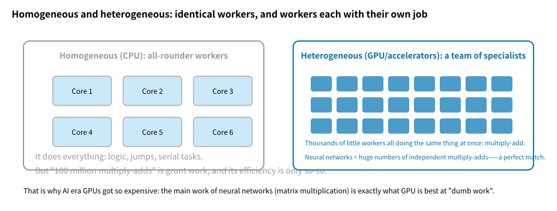
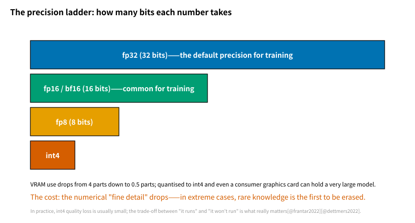
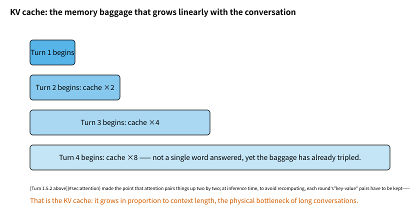
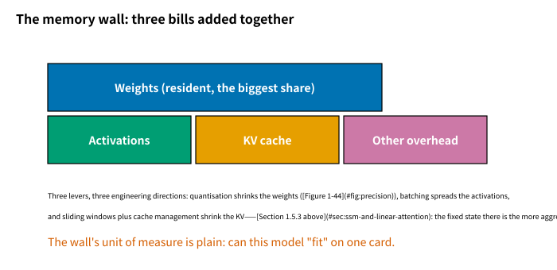

## Deploying a model: homogeneous, heterogeneous, precision and the KV cache {#sec:compute-and-deployment}

### The one-line intuition

All the "training" and "inference" of previous chapters has to land on a real chip in the end. This section answers the last common question: **why is it so expensive and so slow** — and which levers engineers use to make it cheaper and faster.

### Homogeneous and heterogeneous: the all-rounder versus the specialist team

{#fig:homogeneous}

A CPU is **homogeneous** computing: a few dozen identical all-rounder cores that can do anything — logic, branches, serial work. A GPU is the **heterogeneous** idea: thousands of tiny cores, each only able to do one simple thing (multiply and add), but all at once.

The bulk of a neural network's work is **massively independent multiply-adds** — matrix multiplication. That "dumb labour" happens to be the GPU's natural gift. Which is why graphics cards became a strategic material in the AI era: not because the card is magic, but because the task and the tool happen to fit.

### Precision: how many bits each number gets

{#fig:precision}

Every parameter in the model is a number, stored by default as 32-bit floating point (fp32). But inference does not actually need that resolution: 16 bits (fp16/bf16) is nearly lossless, 8 bits (fp8) is common, and 4-bit integers (int4) is the key rung where "will it fit at all" is traded against "quality drops a little"[44][45].

**Quantization** (squeezing high-precision numbers into low precision) pays off directly: VRAM goes from 4 units down to 0.5. The price is coarser numbers — in the extreme, the rarest knowledge is the first to be erased.

### The KV cache: the physical bottleneck of long conversations

{#fig:kv-cache}

[Section 1.5.2](05-02-attention.md#sec:attention) said attention pairs everything with everything; at inference time, to avoid recomputation, the keys and values of every past turn have to stay in VRAM — that is **the KV cache**, and it grows **linearly** with context length. A long conversation can eat your VRAM before it gets to the point.

### The memory wall: three bills added together

{#fig:memory-wall}

At inference, three things live in VRAM: weights (the resident bulk), activations (intermediate computation), and the KV cache (growing with the conversation) — the foreshadowing planted in [Section 1.3.4](03-04-train-and-infer.md#sec:train-and-infer) merges here into the full ledger of "the memory wall". Each of the three levers answers one bill: quantization squeezes the weights, batching spreads the activations, window and cache management squeeze the KV; the fixed state of [Section 1.5.3](05-03-ssm-and-linear-attention.md#sec:ssm-and-linear-attention) is a more aggressive move.

### Built-in limitations: every optimisation is a trade

Quantization costs precision, batching costs latency variance, compressing the context costs detail. **There are no free levers, only explicitly accepted costs** — the whole of deployment engineering is choosing the right costs for the business.

> **Common misconceptions**
>
> That "a big model is necessarily slow". Inference speed depends at once on parameter count, precision, batch size, context length and architecture (the parallel decoding of [Section 1.5.4](05-04-diffusion.md#sec:diffusion)) — "big and fast" and "small and slow" both exist; what matters is the whole engineering chain.

### Summary and self-check

Three sentences: the main work of a neural network is matrix multiplication, which happens to fit the GPU's heterogeneous architecture; quantization trades precision for VRAM and is the key deployment lever; the KV cache grows linearly with context and is the physical bottleneck of long conversations.

Two self-check questions:

1. When the context doubles, which bill in VRAM grows? Which stays the same?
2. Why does "the rarest knowledge disappear first" after int4 quantization? (Hint: recall the manifold of [Section 1.3.3](03-03-learning.md#sec:learning) — rare points live where it is thinnest.)

**Maths note.** fp32 is 32 bits per number; int4 is 4 bits per number, an 8× compression of VRAM. Quantization is essentially mapping continuous values onto the $2^4=16$ levels that 4 bits can represent, and the mapping rules (symmetric/asymmetric, per-layer/per-group scaling) are where the various methods differ[44].
