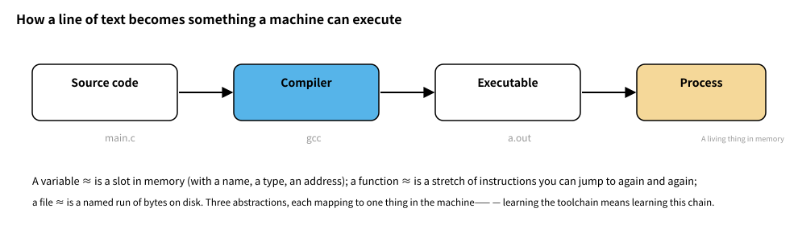
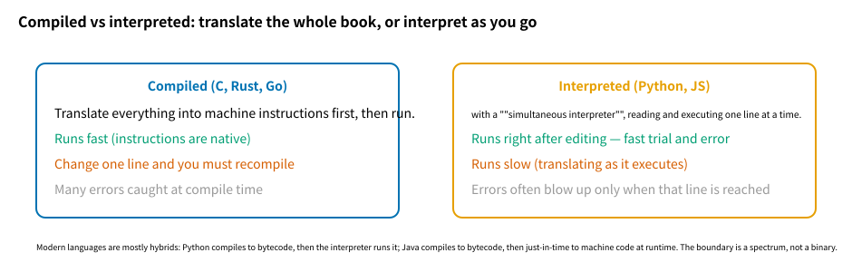
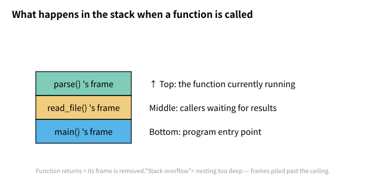

## What a program is: from source code to running {#sec:what-is-a-program}

### The one-line intuition

A program is **a piece of text written for a machine**, plus a conveyor belt that turns it into machine actions. Every tool in this chapter exists to serve one station on that belt.

### The whole chain: from text to process

{#fig:chain}

What you write is called **source code** — text a human can read. A **compiler** translates it into machine instructions and runs a large batch of checks along the way; the result is an **executable file** you can run directly; once launched — by double-clicking or from the command line — it becomes something active in memory: a **process**.

Each of the three abstractions maps to one thing inside the machine. Memorise this table and every tool that follows becomes easy to understand:

**A variable** is a slot in memory — it has a name, a type and an address. **A function** is a stretch of instructions you can jump to again and again — give it input, it gives you output. **A file** is a named run of bytes on disk — it survives a shutdown.

### Compiled versus interpreted: translate the whole book first, or interpret sentence by sentence

{#fig:compile}

Some languages translate the whole book first, then run it (C, Rust): fast to run, and errors surface early. Others read and execute as they go (Python, JS): edit and run immediately, but an error only blows up when execution reaches that line. Most modern languages are hybrids: Python compiles to bytecode before executing, and Java still compiles just-in-time at runtime. **The boundary is a spectrum, not a binary**; what really decides the choice is how often you need to change the code and how fast you need it to run.

### What happens in the stack when a function is called

{#fig:stack}

Every call to a function stacks another "frame" in memory: it holds the function's arguments, its local variables, and where to go back to when it is done. When the function returns, the frame is removed. **Nested calls are stacked frames**; a "stack overflow" means the frames piled past the ceiling — usually meaning some function has been calling itself without end.

### Built-in limitations: every station on the chain can fail

Source code can have syntax errors; a compiler cannot spot logic errors while translating; and at runtime there are errors that only blow up on particular data. **Each kind of error belongs to one station** — which is why a toolchain needs a compiler (to catch compile errors), tests (to catch logic errors) and a debugger (to catch runtime errors): one net per station.

> **Common misconceptions**
>
> Thinking "a program = a source code file". Source code is only the text at the starting point; what actually runs is a process — it has memory, has state, and dies. Understanding that "the code in the file" and "the process in memory" are two different worlds is the precondition for understanding every development tool.

### Summary and self-check

Three sentences: a program is source code turned into an executable by a compiler, which becomes a process when run; variables, functions and files map to memory slots, jumpable instructions and named bytes; compiled versus interpreted is a trade-off about *when* to translate.

Two questions to check yourself:

1. "The program crashed" and "the program won't compile" — at which station of the chain does each error occur?
2. Why are interpreted languages naturally suited to fast trial and error?

**Maths note.** No formulas in this section. One fact about orders of magnitude: a modern CPU executes billions of instructions per second, while a person reads code at a few dozen lines per second — **a machine's "step" is eight orders of magnitude faster than a person's**. That is why performance problems are almost always "the wrong order of magnitude", never "just a little short".
