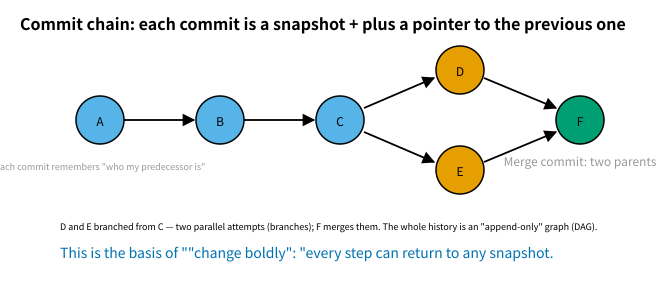
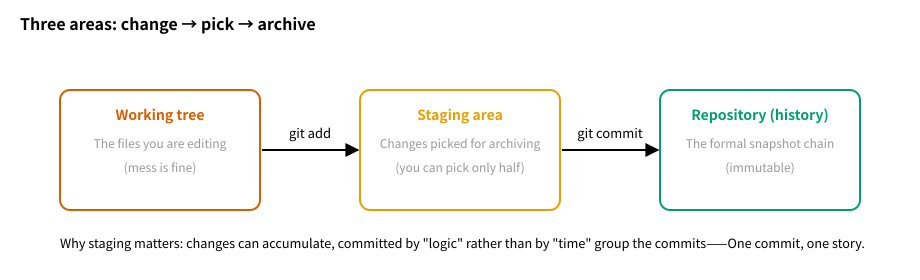
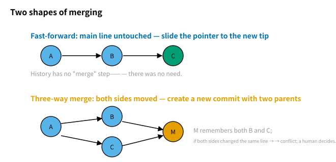

## Tracking changes like snapshots: Git and Git clients {#sec:git}

### The one-line intuition

Git takes **snapshots** of a project: each commit records "what every file looks like right now" and remembers which snapshot came before it. The whole history is an append-only graph — **that is the entire basis for "you can change things boldly"**.

### The commit chain: an append-only graph

{#fig:dag}

Each commit is a snapshot plus a pointer to the previous commit. From any commit you can follow the pointers back through the entire history — nothing can be deleted or overwritten. Two parallel attempts (branches) can be merged at their tips: a merge commit has two "parents" and remembers both sides at once[46].

### Three areas: change → pick → save

{#fig:areas}

The daily flow has three steps: make a mess in the working tree (that is fine) → use `git add` to **pick** changes into the staging area → use `git commit` to save them. The staging area's value is often underestimated: **it lets commits be grouped by logic rather than by time** — one commit telling one story is the baseline for readable history.

### The two shapes of merging

{#fig:merge}

If the main line never moved, the pointer simply slides to the new tip (fast-forward). If both sides moved, Git creates a new commit with two parents (three-way merge). If both sides changed the same line, Git does not guess — it marks the conflict and **leaves the ruling to a human**. A conflict is not a malfunction; it is the system saying "this step needs human judgement".

### Git clients: no need to memorise commands

The command line is the underlying truth, but you need not live in it. Graphical clients turn add/commit/merge into visible operations, and an IDE's built-in Git panel joins "edit — view the diff — commit" into one continuous flow. **Build your intuition with a client first; the command line can fill in any time** — both operate on the same repository, so mixing them is harmless.

### Auditable: who, when, and what changed

Every commit carries its **author and timestamp** — when something goes wrong you can answer precisely who changed that line, and when. Turn on **signed commits** and each commit also carries a private-key signature, so whoever receives the source can verify that the code has not been tampered with since the committer signed it. Snapshot + signature + timeline make up the **audit chain** of the source — that is exactly how this book's sample chapter is kept.

### Built-in limitations: snapshots record content, not intent

Git remembers what every version looked like, but **not why** — "why it was changed this way" lives only in the commit message, and the commit message is hand-written. The ceiling on readable history is set by commit discipline (one thing per commit, and say clearly why). The other boundary is **file type**. Git's diff and merge are designed around lines and work best on plain text: code, configuration, Markdown, LaTeX and CSV can all be tracked line by line; complex packaged formats such as MS Office are mostly beyond it; a non-scanned PDF with a text layer can just about be tracked, while a scan is no different from an image. Binary files can be snapshotted but not diffed line by line, and the repository balloons quickly — that kind of content needs a dedicated storage scheme.

> **Common misconceptions**
>
> Thinking "Git is for programmers only". The snapshot + pointer model holds for any text that changes: papers, contracts, configuration, ledgers. This book's sample chapters live in Git too — every page you are reading has a complete change history you can consult.

### Summary and self-check

Three sentences: Git's history is an append-only graph of snapshots; the three-area flow lets commits be grouped by logic; in the two shapes of merging, a conflict is a question left for a human.

Two questions to check yourself:

1. Why does the staging area improve the quality of the commit history?
2. Two branches changed different parts of the same function — will merging conflict? What if they changed the same line?

**Maths note.** No formulas in this section. One structural fact: commit history is a **directed acyclic graph** (DAG) — "acyclic" guarantees that following pointers never loops back to where you started, which is the structural guarantee that "history cannot be scrambled".
