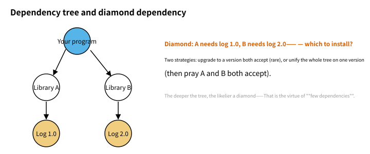
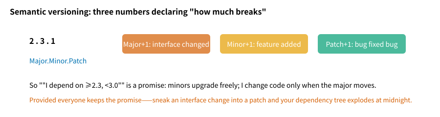

## Resolving dependencies: package managers {#sec:package-managers}

### The one-line intuition

Modern programs are almost all **assembled**: your code plus dozens of libraries other people wrote. A **package manager** is the automated assembler — declare whom you depend on, and it downloads, installs and picks the right versions. Its entire reason for existing: **manual assembly inevitably spins out of control once you pass three dependencies.**

### The dependency tree and diamond dependencies

{#fig:diamond}

Dependencies form a tree: your program depends on libraries A and B, and A and B each depend on others. The classic awkward shape is the **diamond dependency** — A and B depend on different versions of the same library. Which do you install? Two strategies: upgrade to a new version both sides accept, or unify the whole tree on one version and pray. **The deeper the tree, the likelier a diamond appears** — which is why "few dependencies" became a virtue.

### Semantic versioning: declaring breakage with numbers

{#fig:semver}

What makes a diamond negotiable is **semantic versioning** (semver), a convention: the version number has three parts — major.minor.patch. Major +1 means the interface changed (you must change code); minor +1 means a feature was added; patch +1 means a bug was fixed. So "depends on ≥2.3, <3.0" is an executable promise. **The convention is worth only what everyone's adherence to it is worth** — automatic upgrades are safe only in an ecosystem that keeps the promise.

### Package managers are a family

"Package manager" does not name one piece of software but a **layered** family. The **language and runtime layer** manages each ecosystem's libraries — uv/pip for Python, cargo for Rust, pnpm/npm for JavaScript, NuGet/dotnet for .NET. The **system layer** manages the whole machine's software — zypper on openSUSE, apt on Debian-family systems, dnf on Fedora-family ones, pacman on Arch, winget/scoop on Windows, brew on macOS. And there is the more thorough **declarative global layer** — Nix and Guix ([Section 2.6](06-declarative-os.md#sec:declarative-os)). Several layers often coexist on one machine: system packages via zypper, project dependencies via uv — **clear layering with no crossing of boundaries** is the first rule of a clean environment.

### Conflict resolution and lock files

Beyond the two strategies for resolving conflicts, the **lock file** of [Section 2.5](05-reproducibility.md#sec:reproducibility) is a third: pin the resolution result (exact versions for the whole tree) so that "install once" and "install ten thousand times" give the same answer. Declaring dependencies is "what I want"; the lock file is "what was actually obtained" — keeping the two apart is what makes reproducibility possible.

### Built-in limitations: dependencies are borrowed trust

Every package you pull in brings its **transitive dependencies** — a ten-line utility library can drag in hundreds of indirect ones. Supply-chain attacks (a stolen author account, a malicious release) get in through exactly this chain of trust. So the engineering discipline is: **a dependency is a liability, not an asset** — with each one you add, ask "is this feature really worth another chain of trust?"

> **Common misconceptions**
>
> Thinking "package managers solved dependencies". They solved the **automation of downloading and installing**; version conflicts, breaking upgrades and supply-chain security still need conventions (semver), tools (lock files) and discipline (few dependencies) together. Tools turn chaos into something controllable; controllable is not the same as risk-free.

### Summary and self-check

Three sentences: package managers assemble dependencies automatically, and the deeper the tree the more diamonds; semver declares the degree of breakage in three numbers and is the precondition for automatic upgrades; the lock file pins the dependency tree, and is the foundation of reproducibility.

Two questions to check yourself:

1. What does each of the two strategies for resolving a diamond dependency cost?
2. Why is "few dependencies" still a virtue in the AI era? (Hint: think of the chain of trust in [Section 1.7.3](../01-ai/07-03-mcp-skills-rag.md#sec:mcp-skills-rag).)

**Maths note.** No formulas in this section. One combinatorial fact: if each package depends on three others on average and the tree is five levels deep, transitive dependencies can reach $3^5 = 243$ in theory — **the dependency tree grows exponentially**, which explains why "one small project dragging in hundreds of packages" is normal.
