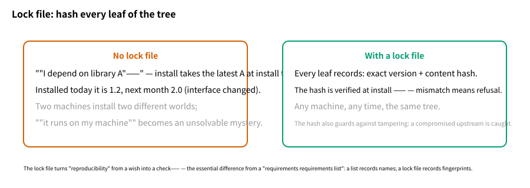
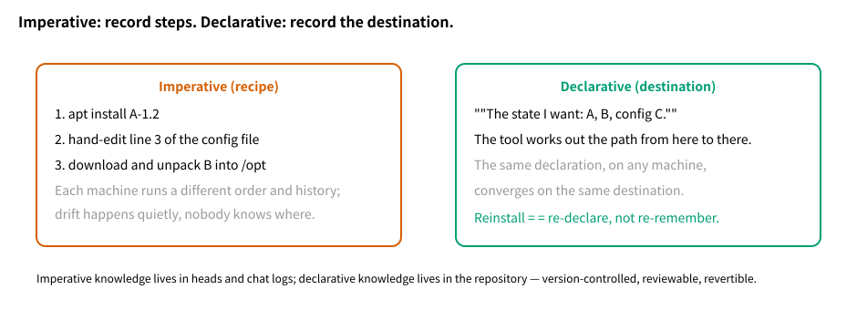

## Keeping behaviour consistent: reproducibility and declarative tools {#sec:reproducibility}

### The one-line intuition

"It runs on my machine" is the most famous sentence in engineering, and the weakest defence. **Reproducibility** has exactly one goal: the same inputs (code + dependencies + environment) produce exactly the same result, on any machine, at any time. It stands on two pillars: the **lock file** ([Section 2.4](04-package-managers.md#sec:package-managers)) and **declarative tools**.

### First, meet the hash: a fingerprint for content

The skeleton of a lock file is the **hash**. A hash function is like a juicer: it presses an input of any size (a file, a whole directory tree) into a short fingerprint of fixed length — with one decisive property: **change one byte of the content and the fingerprint becomes unrecognisable**, and there is currently no way to deliberately construct two inputs with the same fingerprint. So "same fingerprint" becomes a machine-checkable proof of "same content" — the lock files below, and the build outputs of [Section 2.6](06-declarative-os.md#sec:declarative-os), all stake everything on that property.

### The lock file: fingerprinting the whole tree

{#fig:lockfile}

As [Section 2.4](04-package-managers.md#sec:package-managers) said, the lock file pins every leaf of the dependency tree: an exact version plus a content hash. The hash is the content's fingerprint — **if upstream quietly changes one byte, the fingerprint will not match and the install is refused outright**. Reproducibility is therefore not "happens to be the same" but "forced to be the same".

### Declarative versus imperative: record the destination, not the steps

{#fig:declarative}

Two philosophies of configuration. **Imperative** (traditional operations): record the steps — install this first, then edit that file; the steps live in someone's head, and drift between machines happens quietly. **Declarative**: record the destination — "this is the state I want", and the tool works out the path from the current state to it; the same declaration converges to the same result on any machine. Declarative knowledge lives in the repository: it can go into version control, be reviewed, be rolled back.

### Containers: package the environment and carry it with you

Declarative configuration solves "what to install"; containers solve "how to carry it": pack the program together with all its dependencies into an **image**, and it behaves the same wherever it goes. Images also have a layered design — common base layers are shared by all images, and only the layers that changed need downloading again, which makes distribution cheap.

### Levels: reproducibility is stacked up layer by layer

"Reproducible" is not a single switch but a set of layers, **from the inside out**: innermost is the **language-level lock file** ([Section 2.4](04-package-managers.md#sec:package-managers), pinning project dependencies); outside that, **system package management** (pinning the software list of the whole machine); outside that, **container images** (packaging the application with its environment as an immutable distribution unit — the industry standard is called OCI, and tools such as Docker follow it); outermost, a **declarative operating system** ([Section 2.6](06-declarative-os.md#sec:declarative-os)), pinning the kernel and services along with everything else. **The higher the level, the wider the scope of reproduction and the greater the investment** — choose the level your needs require instead of always maxing out.

### Built-in limitations: reproducibility has a cost

Lock files need maintenance (dependency upgrades must be done deliberately rather than happening to you); declarative systems have a learning curve; container images expire (the dependencies inside them age too). **Reproducibility is an ongoing investment**, and what it buys is: a new machine usable within the hour, incidents that can be replayed exactly, and "it runs on my machine" becoming a valid defence from now on.

> **Common misconceptions**
>
> Thinking "reproducible = write the commands down". The commands you wrote down are an imperative recipe, and the machine's history will still make it drift. The test for reproducibility is hard: **a different time, a different machine, byte-for-byte identical results** — fall short of that and you still only have "happens to be the same".

### Summary and self-check

Three sentences: the lock file pins the dependency tree with hashes; declarative configuration records the destination rather than the steps, and the knowledge lives in the repository; containers package the environment to carry with you. Together the three turn "it runs on my machine" into "it runs anywhere".

Two questions to check yourself:

1. Why can a content hash solve both "version drift" and "supply-chain poisoning" at once?
2. A team of three, each with a different development machine. What does declarative configuration give the team in return?

**Maths note.** A content hash (such as SHA-256) maps any input to a fingerprint of fixed length: change one byte of input and the fingerprint becomes unrecognisable, and it is currently impossible to deliberately find two inputs with the same fingerprint. **Equal hash ≈ equal content** — that approximation is the trust foundation of modern software distribution.
