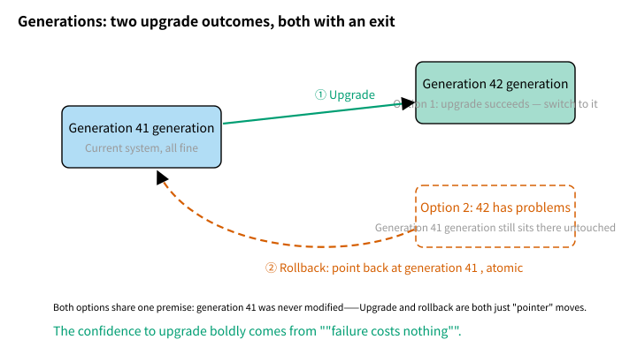
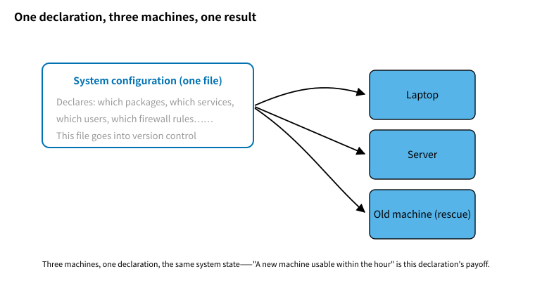

## The operating system, reproducible like code: declarative operating systems {#sec:declarative-os}

### The one-line intuition

[The previous section](05-reproducibility.md#sec:reproducibility) made the application layer reproducible; this section pushes one level up to the top: **the operating system itself can be managed declaratively**. Systems such as NixOS and GNU Guix write "which packages to install, which services to run, who the users are" into a **configuration file**, and the whole system is built from that one declaration.

### Generations and atomic rollback

{#fig:generations}

Every change produces a **new generation**, and the old one is kept exactly as it was; "current" is just a pointer. Did the upgrade go wrong? Point the pointer back at the previous generation — a few seconds, an atomic operation, no need to "take it apart again". **The confidence to upgrade boldly comes from rollback being cheap and complete** — strikingly consistent with Git's commit philosophy ([Section 2.2](02-git.md#sec:git)): immutable history + a movable pointer.

### Configuration and packages from the same source

{#fig:converge}

A deeper unification: package definitions, system configuration and build scripts are written in **the same language**. Change one parameter of a package and everything that depends on it gets rebuilt along with it — the system and its packages cannot quietly drift apart. Push the same configuration declaration to a laptop, a server and an old machine kept for rescue work, and all three converge on the same state ([Figure 1-58](#fig:converge)).

### Operations compared with a conventional distribution

Operations on a conventional distribution are **imperative** ([Section 2.5](05-reproducibility.md#sec:reproducibility)): what was installed and which line of configuration was changed are scattered through the machine's history; moving to a new machine means remembering it all over again. Operations on a declarative system are **commits**: change the declaration, build, switch, and (if needed) roll back — the workflow of [Section 2.2](02-git.md#sec:git) applies unchanged to an entire operating system.

### Built-in limitations: learning curve and ecosystem boundaries

A declarative operating system requires you to **describe everything in its language** — step off its path and you lose its guarantees. Going outside the ecosystem (packaging an obscure piece of software, running a service nobody anticipated) costs more than on a conventional distribution. The engineering judgement: **the more controllability a machine demands (servers, infrastructure), the more it is worth it; a highly freewheeling desktop, not necessarily**.

> **Common misconceptions**
>
> Thinking "declarative = automation script". A script is a run of commands; when it finishes, it is over, and the machine drifts from then on. Declarative is a **standing promise** — the system is checked at all times and pulled back to the declared state. The difference is not the degree of automation; it is whether the destination is explicitly declared.

### Summary and self-check

Three sentences: a declarative operating system writes the state of the whole machine into one declaration; the generation mechanism makes both upgrade and rollback atomic; configuration and packages share a source, and three machines converge on the same state.

Two questions to check yourself:

1. Why does "rollback cheap and complete" change your courage about upgrading? Explain with the commit philosophy of [Section 2.2](02-git.md#sec:git).
2. What kind of machine is a poor fit for declarative management? (Hint: who pays the cost of the declaration?)

**Maths note.** No formulas in this section. One structural fact: the generation model turns system state into an **append-only chain**, isomorphic to Git's DAG ([Section 2.2](02-git.md#sec:git)) — "immutable history + a movable pointer" is a general pattern of reproducibility, recurring from code up to the operating system.
