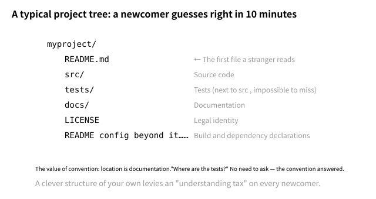
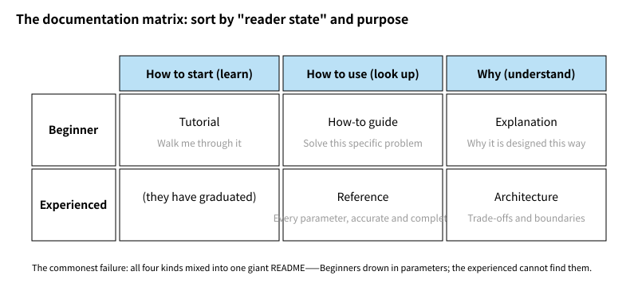

## Making it legible to others: project structure and technical documentation {#sec:project-structure}

### The one-line intuition

The previous sections made a program **runnable and reproducible**; this one makes it **takeable over by someone else**. Both means are astonishingly cheap: **directory structure follows conventions**, and documentation is classified by **the reader's state**. Fail at them and the price is that every newcomer (including you, three months later) has to dig through the ruins all over again.

### The project tree: location is itself documentation

{#fig:tree}

`src/` holds code, `tests/` holds tests, `docs/` holds documentation, `LICENSE` declares the legal identity — none of these conventions is enforced, yet they are the lingua franca of the whole open-source world. **Location is itself documentation**: nobody has to ask where the tests are, because the convention answers for you. Conversely, a clever structure of your own invention levies a "comprehension tax" on every newcomer.

### The documentation matrix: classified by the reader's state

{#fig:docs}

The commonest documentation failure is piling everything into one giant README. Better organisation slices along two dimensions: **the reader's level** (beginner/experienced) × **the reader's purpose** (learning/looking something up/understanding the reasoning), which yields four kinds of documentation each doing its own job — tutorial (walk me through it), how-to guide (solve this specific problem), reference (every parameter, accurate and complete), explanation (why it is designed this way). This matrix is called Diátaxis, and this book's own "one-line intuition / analogy / … / maths note" structure is a variant of it.

### Writing discipline: write for yourself three months from now

The first reader of technical documentation is actually **you in the future** — the you of three months hence has forgotten the trade-offs you made. So the minimum standard for documentation is not literary grace but that **why the decision was made at the time** got written down. Combined with the commit discipline of [Section 2.2](02-git.md#sec:git): the commit message records "what changed and why", and the documentation records "how the whole thing works and why it is designed this way".

### Built-in limitations: documentation rots

Code changed and the documentation did not is more dangerous than no documentation at all — **readers will confidently do the wrong thing following the wrong instructions**. The only fix is to treat documentation as code: put it in version control, and check in the commit that changes code whether the documentation needs to keep up (this book's lint does exactly that: documentation inconsistent with the structure is blocked). Documentation is not something you finish; it is **something you maintain**.

> **Common misconceptions**
>
> Thinking "documentation is for people who don't know how to use it". In the Diátaxis matrix, **the reference manual is precisely for the strongest users** — they remember the usage, not the parameters. Documentation's readers span every level, including the author.

### Summary and self-check

Three sentences: directory structure follows conventions, and location is itself documentation; documentation is split four ways by the reader's state, each doing its own job; documentation is a maintained artefact, not a delivered one, and it rots unless kept in step.

Two questions to check yourself:

1. A newcomer cannot find the test files within ten minutes — is the problem in the structure or the documentation?
2. Why can't a "how-to guide" and a "tutorial" be merged into one piece? (Hint: the readers are in different states — one is learning, one is in a hurry.)

**Maths note.** No formulas in this section. One organisational fact: the 2×2 of the documentation matrix (level × purpose) shows that **the criterion of classification matters more than the classification itself** — pick the right slicing dimension and the content of each cell naturally becomes shorter and more precise.
